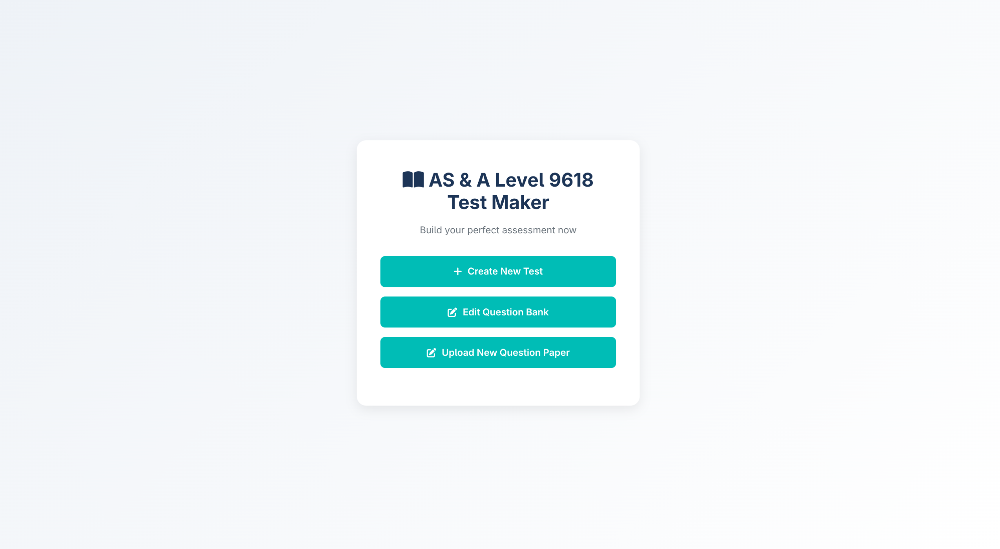
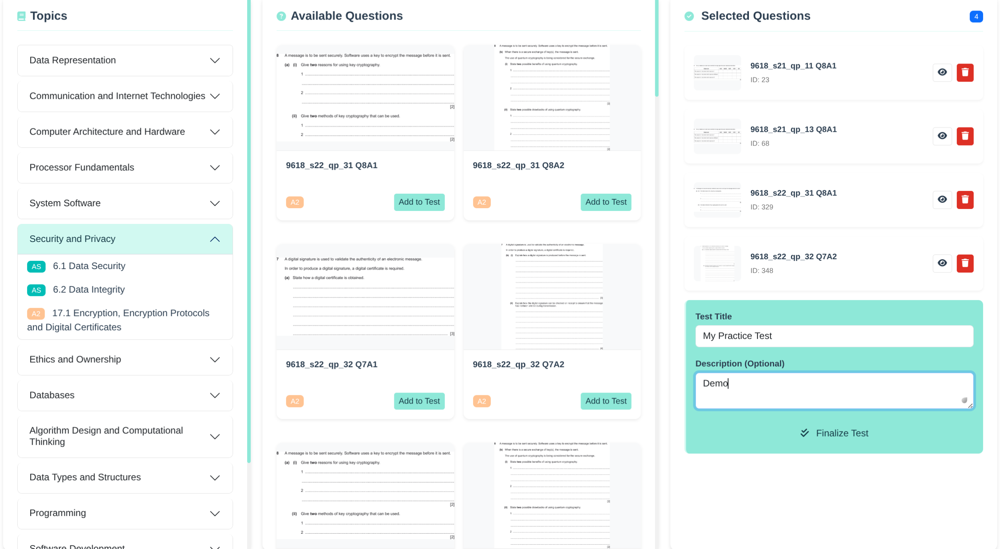
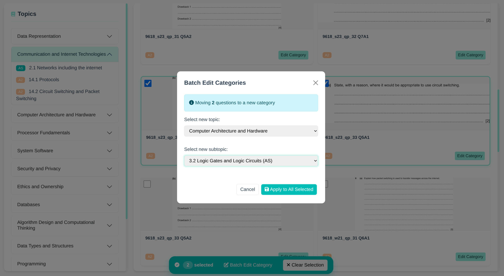

# A-Level 9618 Question Bank

A question bank for Cambridge International AS & A-Level Computer Science (9618), designed to organise past-paper questions for revision and practice.

## Features

- Organised questions for easier navigation and revision.
- Supports targeted practice by topic.
- Designed to help students prepare for examinations.

## Usage

Browse the question bank to find questions relevant to the topics you are studying. Use it alongside the official syllabus and mark schemes for effective revision.

## Disclaimer

This project is an independent educational resource developed by Haorong Xu and is not affiliated with or endorsed by Cambridge International Education.